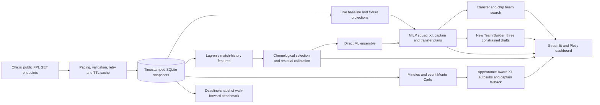

# FPL AI Manager

## Windows desktop app

Download **FPL Manager.exe** from [GitHub Releases](../../releases) and open it.
Enter your FPL team name and manager name, then sign in on the official FPL page
inside the app. It syncs your current squad and transfer details. For standard
recommendations, **Review and apply on FPL** opens the official confirmation
screen inside the app so you can check the moves and points cost before confirming.

See the [desktop and browser setup guide](README_RUST.md) or the
[release checklist](docs/GITHUB_RELEASE.md).

The previous Streamlit application and its documentation below are preserved as the
legacy research interface. Launch it separately with `RUN_LEGACY_STREAMLIT.bat`.

**Repaired release — 2026-11-18:** Includes a real CPU-trained local model, public player-history cache, faster page navigation, and inline team loading in My Team. Extract the whole ZIP and run `RUN_FPL_MANAGER.bat`; retraining is optional. See [Local ML verification](docs/LOCAL_ML_VERIFICATION.md).

A Fantasy Premier League assistant using real official data, chronological
ML experiments, event simulation and mixed-integer optimization. Built as an applied
ML and optimization research project. It does not execute transfers or request an
FPL password. The implemented season profile is **2026/27**, verified against the
live official rules and bootstrap response on 2026-10-29.

**Status:** working research application, not a validated production service or a
proven season-winning strategy. Real-data tests and limitations are recorded in
[verification](docs/VERIFICATION.md). No comparison with human managers is claimed.

## Start locally (Python 3.12+)

```bash
python -m venv .venv
# Windows Command Prompt:
.venv\Scripts\activate
# macOS/Linux instead: source .venv/bin/activate
python -m pip install -e ".[ml,dev]"
fpl-ai refresh
streamlit run app/main.py
```

For the legacy Streamlit app on Windows, double-click `RUN_LEGACY_STREAMLIT.bat` after extracting the whole repaired ZIP and installing Python 3.12+. The trained model and public data are included; see the Local ML section below. Dependencies install on first launch only. Native Windows batch execution was not available in the verification environment.

Open **http://localhost:8501**. Rankings and fixture planning work immediately with
live data. **No team yet? Open New Team Builder** to create your first squad without a team ID. Settings lets you verify a saved connection by team and manager names and load its last-deadline picks, correct
later changes, and manually confirm bank, actual selling prices, free transfers and
unused chip instances. These inputs are required for transfer decisions and remain
in the browser session; no login credentials are supported. Public team snapshots
are cached locally and must not be committed or shared accidentally.

To use learning and event distributions:

```bash
fpl-ai refresh --histories   # paced, cached, resumable; 669 players in the observed snapshot
fpl-ai train               # requires optional ml dependencies above
fpl-ai rank --horizon 5
fpl-ai optimize --horizon 5 # new £100m squad; not your current-team transfers
fpl-ai tune --trials 20    # training-only expanding Optuna folds; reports, does not silently retune benchmark
pytest -q
ruff check .
ruff format --check .
```

Choose **Locally trained ML** in the dashboard after training. Never load untrusted
joblib/pickle artifacts. Training writes local model/metrics files; these and raw
football data are ignored by Git. CLI ranking/optimization intentionally default to
the transparent baseline; the dashboard supports selecting the local ML artifact.
`--db PATH` is a global option placed before a subcommand. Offline CLI commands use
stored data; check timestamps and refresh before acting.

## Build your first team — no FPL ID needed

[Implementation and test report](docs/NEW_TEAM_BUILDER.md).

1. Launch the dashboard and open **New Team Builder** in the sidebar.
2. In the page's builder form select **Baseline**, **Locally trained ML**, or
   **Event simulation**, plus a **1, 3, 5 or 8 gameweek** horizon and risk preference.
   Baseline works with bootstrap/fixtures alone. Local ML uses the included trained artifact (or retrain through Local ML);
   event simulation requires real player histories. Missing prerequisites produce
   an actionable error, never an undisclosed model fallback.
3. Optionally lock players you must have and exclude players you do not want.
   Click **Generate three squads**. Every variant uses the existing `solve_squad`
   with the official season budget, position counts, formations and club maximum.
4. Compare **Maximum expected points**, **Balanced**, and **Differential-focused**.
   Select a variant to view its pitch, captain/vice, reserve goalkeeper, ordered
   outfield bench, all fifteen prices, per-GW forecasts/fixtures and selection reasons.
5. Use **Download squad CSV** or **Save draft locally**. Local drafts are stored in
   `data/processed/new-teams/`, ignored by Git and persisted by the existing Docker
   data volume. On a hosted app this is server-local storage; the download goes to
   your own computer. **Load saved draft as player locks** restores IDs only;
   regenerate to check current prices, availability and forecasts.
6. Create the actual team yourself on the official FPL website. **Open weekly
   management Settings** lets you enter your own ID later. Load public picks when
   available, correct any later changes and confirm actual finances/chips before
   using the existing My Team/Transfers workflow. Public picks can be unavailable
   until the first deadline. Drafts never become confirmed account ownership/bank.

The builder has its own model/horizon/risk form; other pages' sidebar forecasting
controls do not change an existing builder result. Changed controls or source data
invalidate exports until regeneration. Locks/exclusions are hard constraints;
unknown or unsupported locked players must be unlocked explicitly. Three squads
are distinct when feasible. If locks force one squad, it is shown and the other
variants are reported unavailable; constraints are never silently relaxed.

### Transparent preference objectives

For a per-GW player mean `mu` and risk proxy `r`, Conservative uses `mu − .25r`,
Balanced uses `mu`, and Aggressive uses `mu + .25r`. This risk preference applies
to the Balanced and Differential-focused variants. The maximum-expected-points
reference always optimizes unadjusted means. Balanced additionally subtracts
`.10 * max(mu, 0) * (1 − reliability)`; Differential-focused adds
`.25 * max(mu, 0) * (1 − ownership/100)`. Unknown ownership gets no bonus.

Baseline/ML use empirical historical points dispersion (scaled by fixture count
and next-GW availability) with availability exposure as a minimum. Without usable
history only the explicitly labeled availability proxy is used. Reliability is
historical mean minutes/90, bounded to 0–1, or the availability heuristic if missing.
Event simulation uses its own seeded point standard deviation. These are heuristic
preferences, **not calibrated uncertainty or extra expected FPL points**.

Preference scores select lineups/captains and rank the outfield bench; reported
team points are recomputed from the original forecasts, counting weekly XI plus
captain. Player horizon totals include their own fixtures, even if benched. Vice
is the highest next-GW preference score among other starters. The reserve GK is
separate from outfield bench priorities 1–3. Expected autosubs/captain fallback are
not included in builder totals; the existing statistical lineup module remains
available in My Team. Event simulation still uses marginal historical event rates,
not opponent-conditioned or correlated team outcomes. No real transfers or FPL
registration actions are performed.

## Architecture



Modules live under `src/fpl_ai/`; UI under `app/`; offline deterministic tests under
`tests/`; decisions are advisory throughout. SQLite is behind `SnapshotStore`, a
small append-only persistence interface. A PostgreSQL implementation would replace
that boundary with migrations/JSONB and concurrency tests; PostgreSQL is not yet
implemented.

## What works

- All six requested public endpoint families plus public entry history; snapshots,
  freshness display, bounded retries and conservative 0.4s minimum request spacing.
- Player, price, ownership, news, transfers, xG/xA/xGI, ICT, defensive and match
  statistics are retained from source responses when present. Missing values stay
  missing. Price history is observable from snapshots and match-history `value`;
  price-change forecasts from upstream are not treated as observed future prices.
- Baseline fixture-aware rankings, value/differentials, blank/double gameweeks,
  dashboard filtering, CSV export and interactive formation/fixture plots.
- Ridge, RF, gradient boosting, LightGBM and XGBoost; equal-weight ensemble of two
  models selected by validation MAE, plus simple lag-form/average comparisons.
- Train/selection/calibration/test partitions keep entire gameweeks together;
  test MAE, RMSE, Spearman, top-20 fixture-row overlap, regression calibration bins,
  bias and empirical interval coverage. Selection is not performed on the test set.
- Position-specific scoring of empirical minutes and simulated attacking,
  concession, save, bonus, defensive and disciplinary events; point distributions.
- MILP budget, squad size, positional counts, club maximum, weekly formations and
  captain; actual sales/bank/free transfers, four-point hits, explicit roll plans.
- Statistical lineup refinement evaluates simulated autosubs, reserve GK,
  captain/vice fallback and bench order, with documented risk utility.
- 1–8 GW fixed-price transfer beam planning and a joint four-chip beam search;
  chip-instance windows, one chip per week, Free Hit reversion/consecutive-use
  restriction, Wildcard persistence and saved-free-transfer retention.
- Historical manager benchmark code accepts real archived pre-deadline snapshots,
  with form, historical-average and official-forecast baselines. It refuses missing
  snapshots instead of publishing fabricated season performance.

## Model methodology and actual evidence

The observed current season has only eight finalized gameweeks. The recorded
experiment used GW2–5 for training, GW6 for selection, GW7 for residual-interval
calibration and GW8 (668 player-fixture rows) for the untouched test. Ensemble MAE
was **1.2581**; Ridge **1.2453**, lag-3 form **1.3468**, lag-10 average **1.2878**.
One week cannot establish persistent improvement or manager performance. Players
with no minutes dominate parts of the table; inspect ranking metrics as well as MAE.
[Experiment details](docs/METHODOLOGY.md) and [machine-readable results](docs/evaluation.json).

Features use lagged per-fixture means across the previous 3/5/10 gameweeks, points
variability, prior samples and rest. Fixtures in one gameweek share pre-deadline
features. Today’s prices, ownership, injury news, set-piece order, fixture difficulty
and club strengths are excluded from historical ML. Current histories can contain
later official corrections; this is a reconstructed-outcome experiment, **not a
fully point-in-time historical evaluation**. Historical lineups/positions, rotation
news and archived fixture schedules require additional provenance.

The baseline uses 0.7 official form + 0.3 season average, summed over scheduled
fixtures and scaled by `clip((3/FDR)^0.35, .75, 1.25)`. Only the next GW receives the
current availability factor; no recovery date is invented. Beyond that horizon,
injury and rotation trajectories are unresolved. These adjustments are heuristics,
not validated learned effects. New players without usable history may lack a
forecast and are excluded from optimization rather than assigned invented stats.

## Optimization and recommendations

Binary `x_i` selects a 15-player squad. For each week, `s_i,w` selects eleven and
`c_i,w` selects one captain. Enforce `c <= s <= x`, season position and club limits,
and valid formations. For current squads:

```
new-purchase spending <= bank + actual proceeds from transferred-out players
transfers = 15 - number of kept players
paid transfers >= transfers - free transfers
objective = sum(projected XI points + captain bonus) - 4 * paid transfers
```

Chip-aware variants score all fifteen for Bench Boost or add a second captain
bonus for Triple Captain. Costs are integer tenths of £m. Selling profits use half
price-rise rounded down only when a known purchase price is supplied; the transfer
UI requires actual selling prices. No future price growth is assumed. Main MILP
forecasts exclude fallback/autosubs; the separate statistical lineup search includes
them approximately through scenarios. Beam search proposes a limited set of
current transfers, updates budget/squad/free transfers and reruns each gameweek;
it has no global optimality or whole-season guarantee.

Transfer explanations show exact objective gain against rolling, projected incoming
and outgoing points, historical minutes, status and budget. They distinguish
forecasts from heuristic fixture/availability effects. `feature_sensitivity` offers
median-replacement prediction sensitivity; this is not causal attribution or SHAP.

## Dashboard pages

Overview, **New Team Builder**, Player Rankings, My Team, Transfers, Captaincy, Fixture Planner, Chip
Planner, Model Performance and Settings. The pitch uses the actual selected player
IDs and projections. Screenshots can be added under `docs/media/` after capturing a
real dashboard; no synthetic screenshot or team result is presented.

## Backtesting and automatic updates

Save snapshots regularly before deadlines, plus finalized `event/{gw}/live/` results.
[Operations and data guidance](docs/DATA_AND_RULES.md) describes provenance and gaps.

```bash
fpl-ai backtest --start 9 --end 12
```

This will fail clearly unless all necessary pre-deadline snapshots and final actual
results exist. There is **no season score yet**. Official current endpoints do not
provide past injuries, ownership, transfer prices or fixture schedules as known at
each deadline. Bulk historical archives are not silently downloaded or relicensed.
Backtesting evaluates the three defined baselines with no chips and at most one transfer/week. `--include-ml` adds deadline-local retraining using only archived pre-deadline player histories, with an explicit early-season form fallback. Full ML/chip season validation is unfinished.

Schedule `fpl-ai refresh --histories` externally (cron or Windows Task Scheduler).
The dashboard refresh button updates bootstrap/fixtures, not all 669 histories;
its in-process cache expires after five minutes and HTTP snapshot TTL is fifteen
minutes. Use `fpl-ai refresh` for immediate bootstrap/fixture updates. No background
scheduler needs an FPL account. Live results must be collected explicitly through
`FPLClient.live(gw)` or the collection command documented in operations.

## Deployment

```bash
docker build -t fpl-ai-manager .
docker run --rm -p 127.0.0.1:8501:8501 -v fpl-data:/app/data fpl-ai-manager
# Optional training libraries in image:
docker build --build-arg FPL_EXTRAS=ml -t fpl-ai-manager:ml .
```

The image runs as UID 10001; named volumes avoid host-directory ownership surprises.
For hosted use, put an authenticated reverse proxy in front, use TLS, persistent
storage, dependency updates and backups. Do not expose personal team settings on
an unauthenticated shared instance. Docker health checks cover the web process,
not upstream availability. CI runs offline tests/lint and builds the default image.
[Deployment notes](docs/DEPLOYMENT.md).

## Remaining research work

- Properly licensed multi-season deadline archives and selection-time covariates;
  full-season walk-forward ML/chip validation and verified historical position mappings.
- Team-shared event dependence, opponent-conditioned rates, calibrated minutes and
  position-specific estimators, better new-player cold starts and fixture congestion.
- Official assist attribution and BPS/rank ties cannot be reconstructed perfectly
  from xG/Poisson rates. Bonus is empirical, not a full BPS model.
- MILP formation selection is deterministic; statistical XI search is local and uses
  limited simulations. Player covariances and whole-season chip option value remain
  approximations. Saving outside an 8-week horizon has no terminal value.
- Purchase-price changes, GW1 unrestricted entry, midseason special transfer
  overrides and newly changed scoring need reviewed season support. Unknown seasons
  fail closed; event-specific overrides are not silently applied.
- PostgreSQL, multiuser authentication, deployed monitoring and load/security review
  are future engineering work. Unit tests alone do not establish production quality.

## Sources, ownership and license

Official [FPL](https://fantasy.premierleague.com/), [rules](https://fantasy.premierleague.com/help/rules),
[terms](https://fantasy.premierleague.com/help/terms). Unofficial API use may change or
be restricted; respect throttling and source terms. No guaranteed API SLA or
published numerical rate allowance was found. **MIT applies to this code only.**
FPL data and trademarks retain their owners’ rights; this project is not affiliated
with or endorsed by the Premier League. Do not redistribute raw data or commercialize
it on the assumption the code license grants those rights.

## Local ML: ready-to-run Windows release (2026-11-18)

This ZIP **includes a trained model** in `models/`, its real-data report in `reports/`,
both historical training CSVs, and public current-season player histories in
`data/fpl.sqlite`. You do not need to train or download hundreds of histories before
opening the app. No FPL account credentials or personal team records are included.

1. Extract the **entire** ZIP into a new folder. Keep your previous folder as a backup;
   do not replace an existing user database with the bundled public database.
2. Install 64-bit Python **3.12** and double-click `RUN_FPL_MANAGER.bat`.
3. The launcher installs dependencies only when missing or incompatible. Later launches
   skip installation. It no longer runs a blocking API refresh before opening Streamlit.
4. Open **My Team**, enter your FPL team name and manager name. For the first connection,
   verify once in the Rust app using its browser helper (see PLAYING_STYLE_UPDATE.md).
   The legacy Streamlit app can reuse that verified connection.
5. Open **Settings** to correct post-deadline transfers and confirm current selling
   prices, bank, free transfers and unused chips before using **Transfers**. Team inputs
   stay in the browser session and must be loaded again after restarting it.

The team-loading message in the previous release indicated that no squad was loaded;
it was not a model error. My Team now includes the lookup directly, with a manual-entry
route to Settings. A new team can use **New Team Builder** without a team ID. The builder
and all other ML pages now use the same model registry; the previous builder incorrectly
looked only for `models/ensemble.joblib` while Local ML saved `models/local-*.joblib`.

### Starting from PowerShell

```powershell
py -3.12 -m venv .venv
.\.venv\Scripts\python.exe -m pip install --upgrade pip
.\.venv\Scripts\python.exe -m pip install -e "."
.\.venv\Scripts\python.exe scripts\verify_local_install.py
.\.venv\Scripts\python.exe -m streamlit run app\main.py
```

Explicit interpreter paths avoid activation-policy issues. The core installation includes
LightGBM and pins scikit-learn to the **1.8.x** series used by the bundled artifact.
`requirements-lock.txt` lists tested direct dependency versions, with no Linux-only NVIDIA
packages. It does not pin all transitive dependencies. XGBoost and Optuna are optional:
install `.[ml]` to use them for retraining. Install `.[dev]` to run pytest and Ruff.

### Included model and measured results

The artifact `models/local-20261118T001337021377Z.joblib` was trained on real public
2023/24 and 2024/25 archive data, on CPU. Assistant-manager records were excluded.
The pipeline prepared **55,347 player-fixture rows**, split chronologically into
33,391 training, 10,366 validation and 11,590 test rows. Training ends at 2024/25 GW8;
validation is GW9–23; the untouched test period is GW24–38.

| Target | Validation-selected predictor | Test MAE | Test RMSE |
| --- | --- | ---: | ---: |
| FPL points per fixture | LightGBM | 0.9618 | 1.8888 |
| Minutes per fixture | Recent form (last five matches) | 12.9714 | 24.6034 |

Random Forest, LightGBM and XGBoost were actually trained for both regression targets.
Recent form won the minutes validation comparison; it was retained rather than forcing
a worse learned model. Points test MAE compares with 0.9889 for recent form and 1.0228
for historical average. These are results over **all rows, including zero-minute and
zero-point records**, not accuracy estimates specifically for a starting XI. No claim
of future accuracy or winning FPL performance is made. Goal, assist, clean-sheet and
start probabilities also have saved classifiers, Brier scores and calibration reports.

The report includes dataset hashes, features, parameters, runtime versions, test bias,
position/season breakdowns where present and selected-tree importance. Evaluation prints
the saved test results without retraining. Production predictions freeze the available
history across the horizon, and never train on the current prediction targets.

### Performance fixes and updating data

- Page changes reuse loaded models and cached forecasts. Revision keys avoid hashing
  the complete public API payload on each navigation.
- Histories are read with one database connection, rather than one per player.
- Fixture effects are computed once per club/gameweek, rather than per player/gameweek.
- Ordinary navigation uses stored public snapshots and does not wait for network retries.
  The timestamp and stale-data warning are visible: use **Refresh live data** to update
  prices, injuries and fixtures before acting on recommendations.
- Full history downloads run only when explicitly requested. **Local ML → Download/update
  training data** downloads historical CSVs; **Update current player histories (optional)**
  is a separate, paced operation. Training automatically downloads missing historical
  files and shows preparation/training logs. Refreshing metadata alone does not retrain.
- Local ML and Model Performance open independently of live API access. Model Performance
  shows the new reports rather than only the legacy experiment's report path.

On the implementation machine (Linux, 672 real players), the first Overview load took
5.82 seconds. Subsequent page loads took about **0.04–0.93 seconds**, a populated My Team
0.40 seconds, and generating three ML squads 5.61 seconds. These measurements exclude
first-time package installation and are not Windows performance guarantees. Sources and
raw timings are in `reports/live-page-smoke.json`, `reports/live-builder-smoke.json` and
`reports/performance-repair.json`. Expensive scenario/chip searches remain explicit actions.

### Optional retraining and prediction commands

```powershell
# Install extra comparison models and test tools if needed.
.\.venv\Scripts\python.exe -m pip install -e ".[ml,dev]"
# Historical downloads and current-season history export (several minutes for all players).
.\.venv\Scripts\python.exe -m fpl_ai.ml download_data --seasons 2023-24 2024-25
# The packaged CSVs can also be used directly, with no download.
.\.venv\Scripts\python.exe -m fpl_ai.ml train --seasons 2023-24 2024-25 --cpu
.\.venv\Scripts\python.exe -m fpl_ai.ml evaluate
.\.venv\Scripts\python.exe -m fpl_ai.ml predict --horizon 3 --output reports\predictions-first.csv
.\.venv\Scripts\python.exe -m pytest -q
```

`--model` selects an explicit artifact. `--input path1.csv path2.csv` trains on exactly
those CSVs, with archive-compatible columns and a `season` column. Do not pass duplicate
season versions. Default training uses the newest archive version per requested season,
plus the newest completed current-season export if its season is not already selected.
Downloads with `--refresh` add versions instead of replacing CSVs; prediction output uses
exclusive creation and refuses to replace existing files. Models and reports use UTC
versioned filenames and load without retraining. Load only trusted local joblib files.

Training uses 60%/20%/20% chronological season/gameweek groups. Rolling features cover
3, 5 and 10 matches; the entire target gameweek is excluded from history, including
both fixtures of a double. Completion is approximated as kickoff plus three hours,
before earliest target-round kickoff minus 24 hours. Corrected archive statistics and
missing publication timestamps prevent a strict archived point-in-time guarantee.
Missing optional statistics are imputed from the training partition only. Missing
probability labels are never fabricated; models require sufficient examples in every
partition and are selected against prevalence using validation Brier score.

GPU training is optional: omit `--cpu` to request NVIDIA detection and supported GPU
training. Unsupported builds retry on CPU. No GPU execution was tested or claimed.
The Windows LightGBM wheel's acceleration support depends on its build.

### Recommendation behavior and limits

The optimizer enforces 15 players, positional quotas, a £100m new-team budget, club limits,
legal weekly XIs, captaincy and existing-team selling prices/transfer costs. Existing-team
JSON in Local ML takes `owned`, `bank`, `sale_prices`, `free_transfers`, optional
`max_transfers`, `chip`, `available_chip_ids` and `previous_chip`. All prices are integer
£0.1m units. Confirm actual selling prices in FPL. Unsupported season rules fail closed.

Predictions use lagged player outcomes (including xG/xA where present), not trained
opponent strength, home/FDR, ownership, price or injury-recovery effects. Scheduled
fixtures are summed so blanks score zero and doubles include both matches. Displayed
minutes/probabilities are **per fixture**, not weekly totals or probabilities of at least
one return during a double. Sparse-history players rely on imputation (`history_samples`
is shown). Historical blanks are absent. Scoring and player behavior may change between
training seasons and the current season.

One immediate transfer set is held across the horizon with weekly XI/captain changes;
the new adapter does not schedule later transfers or future chip dates. Bench order and
vice-captain use expected points and do not optimize autosub expectations. Existing
appearance-aware tools remain available. See `docs/LOCAL_ML_VERIFICATION.md` for actual
checks and limitations. Native Windows execution was not available in this environment.
